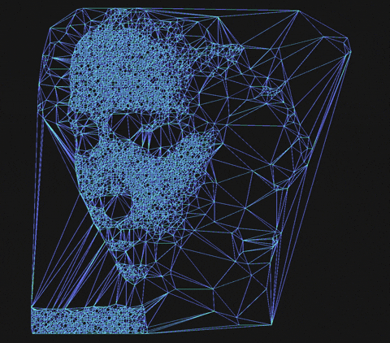

<table align="center" border="0">
  <tr>
    <td align="center" valign="top" width="30%">
      <!-- Substitua meu-gif.gif pelo nome exato do arquivo que você subiu -->
      
    </td>
    <td valign="top" width="70%">
      <h3>Olá! Meu nome é Guilherme.</h3>
      <ul>
        <li>💻 Atuo como Analista de Sistemas e Suporte na FFM/USP _ centro de SP;</li>
        <li>🎓 Formado em Análise e Desenvolvimento de Sistemas pelo SENAC;</li>
        <li>🛡️ Atualmente focado em estudos e certificações na área de Cybersecurity (Red Team / Blue Team) e certificação Google Professional Cloud Architect e Generative AI Leader;</li>
        <li>🌎 Estudando inglês para aprimorar minha carreira;</li>
        <li>🎮🤖 Geek.</li>
      </ul>
    </td>
  </tr>
</table>

 

### 📊 Estatísticas do GitHub

<table align="center" border="0">
  <tr>
    <td>
      
    </td>
    <td>
      
    </td>
    <td>
      
    </td>
  </tr>
</table>

---

  <picture>
    <source media="(prefers-color-scheme: dark)" srcset="https://raw.githubusercontent.com/Gwiill/Gwiill/output/github-contribution-grid-snake-dark.svg">
    <source media="(prefers-color-scheme: light)" srcset="https://raw.githubusercontent.com/Gwiill/Gwiill/output/github-contribution-grid-snake.svg">
    
  </picture>

