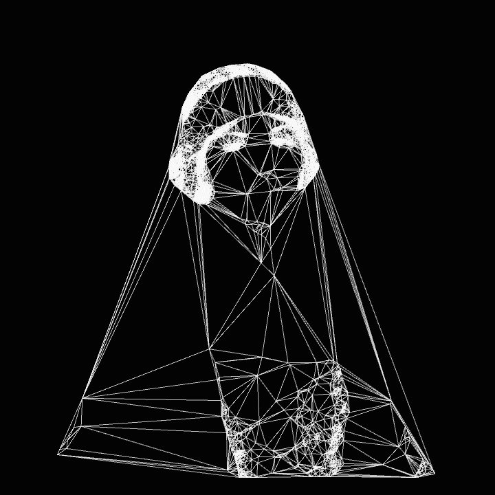

### Hi, I'm Guilherme — a Systems Analyst, Support Specialist & Cybersecurity :)
<table align="center" border="0">
  <tr>
    <td align="center" valign="top" width="22%">
      
    </td>
    <td valign="middle" width="50%">
      

        <picture>
          <source media="(prefers-color-scheme: dark)" srcset="https://raw.githubusercontent.com/Gwiill/Gwiill/output/github-contribution-grid-snake-dark.svg">
          <source media="(prefers-color-scheme: light)" srcset="https://raw.githubusercontent.com/Gwiill/Gwiill/output/github-contribution-grid-snake.svg">
          
        </picture>
      

      <ul style="font-size: 13px; ">
    <h6>🎓 Formado em Análise e Desenvolvimento de Sistemas pelo SENAC - 💻 Atuo como Analista de Sistemas e Suporte na FFM/USP _ SP - 🛡️ Focando em estudos e certificações Cybersecurity/Google  Cloud Architect - 🏍️ 💨 Entusiasta de motos - 🎮 Geek.</h6>
        
  </ul>
</td>
    </td>
  </tr>
</table>
 

---

<table align="center" border="0">
  <tr>
    <td>
      
    </td>
    <td>
      
    </td>
  </tr>
</table>

  
  
  
  
  
  
  
  
  
           
  

